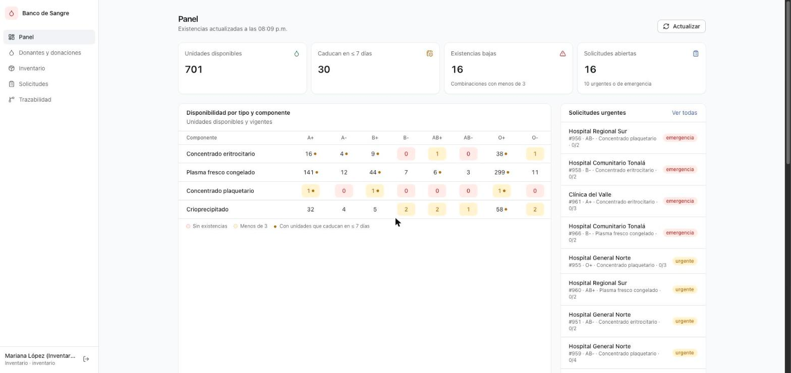
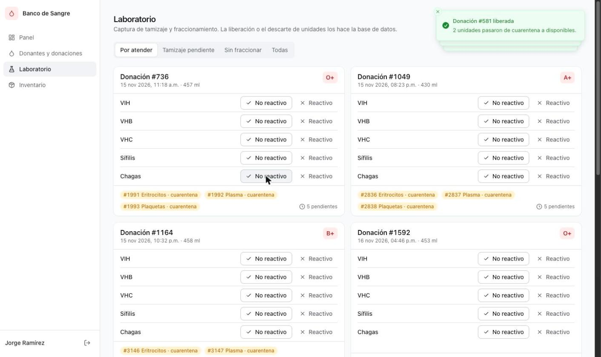
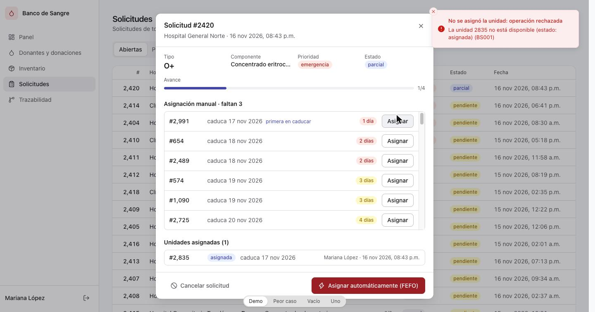
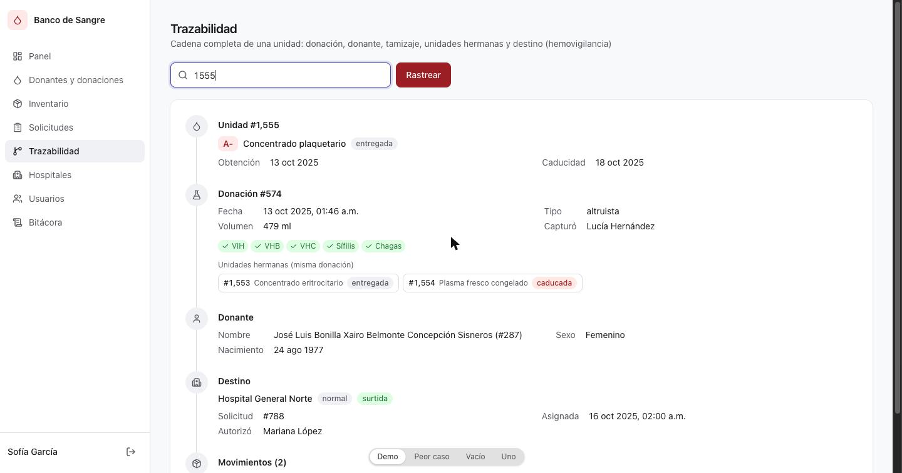
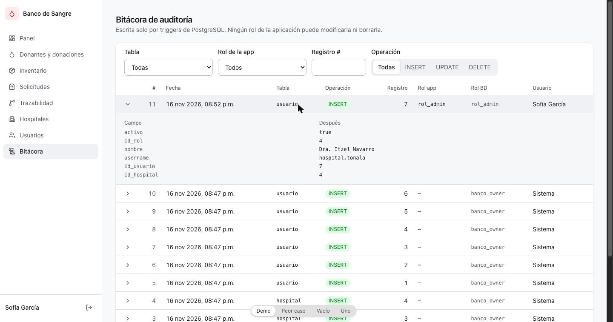
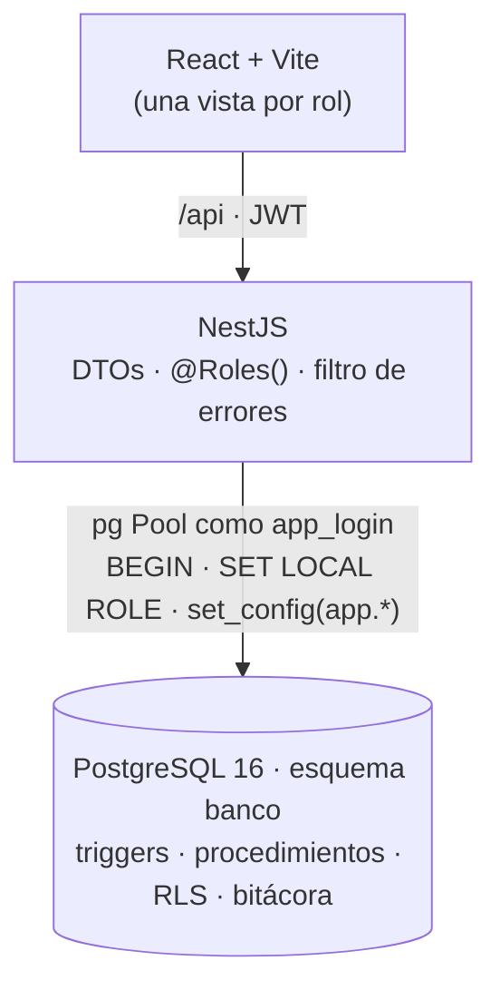
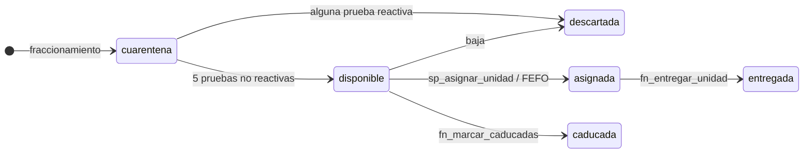

# 🩸 Banco de Sangre — Sistema de administración

**Una aplicación web en la que la base de datos protege al paciente aunque la aplicación falle.**

Gestiona el ciclo completo de un banco de sangre: donante → donación → tamizaje → fraccionamiento →
inventario → solicitud hospitalaria → asignación → entrega → trazabilidad. Las reglas críticas
(no entregar una unidad caducada, reactiva o asignada dos veces) **viven en PostgreSQL**:
triggers, procedimientos, constraints, roles, RLS y bitácora. NestJS y React son capas delgadas.




> Proyecto integrador de **Administración de Bases de Datos** · Universidad de Guadalajara, CUCEI · noviembre de 2026.

---

## Lo más destacado

| | |
|---|---|
| **Falla segura** | Toda unidad nace en `cuarentena`. Un trigger la libera solo cuando las 5 pruebas de tamizaje (VIH, VHB, VHC, sífilis, Chagas) salen no reactivas; si una sale reactiva, descarta todas las unidades de esa donación. |
| **Concurrencia real** | `sp_asignar_unidad` bloquea la fila con `SELECT … FOR UPDATE`, y una UK en `asignacion` sirve de segunda barrera. Con 20 transacciones simultáneas sobre la misma unidad, **1 tiene éxito y 19 se rechazan**. |
| **FEFO sin esperas** | La asignación automática toma primero las unidades que caducan antes, con `FOR UPDATE SKIP LOCKED`, así que las solicitudes simultáneas no se bloquean entre sí. |
| **Privilegios mínimos + RLS** | 5 roles `NOLOGIN` con GRANT por tabla y columna. Cada hospital solo ve sus solicitudes (Row-Level Security), y ningún rol puede hacer `UPDATE` directo sobre las unidades. |
| **Auditoría inmutable** | Un trigger genérico registra cada INSERT/UPDATE/DELETE con el rol y el usuario reales de la app, incluso dentro de funciones `SECURITY DEFINER`. Nadie puede modificar ni borrar la bitácora. |
| **Rendimiento medido** | Con 100 000 unidades, un índice parcial reduce la consulta de disponibilidad un **98.7 %** y la selección FEFO un **99.6 %**. |
| **Recuperación a un punto en el tiempo** | Archivado de WAL + `pg_basebackup` + `recovery_target_time`: se recupera en menos de 1 s perdiendo 5 donaciones, contra 35 con `pg_dump`. |

## Capturas

<table>
  <tr>
    <td width="50%"></td>
    <td width="50%"></td>
  </tr>
  <tr>
    <td><b>Tamizaje.</b> Al capturar la quinta prueba no reactiva, la base de datos libera la donación: las unidades pasan de cuarentena a disponibles.</td>
    <td><b>Rechazo de la BD.</b> Dos personas asignan la misma unidad y la segunda recibe <code>BS001</code>. El mensaje viene del <code>RAISE EXCEPTION</code>.</td>
  </tr>
  <tr>
    <td></td>
    <td></td>
  </tr>
  <tr>
    <td><b>Trazabilidad (hemovigilancia).</b> Unidad → donación → pruebas → unidades hermanas → donante → hospital de destino.</td>
    <td><b>Bitácora de auditoría.</b> La escriben solo los triggers, con el rol de BD, el rol de la app y el usuario.</td>
  </tr>
</table>

Las 34 capturas (vistas por rol, versión móvil y pruebas con datos de peor caso) están en
[`docs/evidencias/capturas/`](docs/evidencias/capturas/).

## Arquitectura



Cada petición corre en su propia transacción con el rol real del usuario (`DbService.withContext`).
Así los GRANT, las políticas RLS y la bitácora ven a la persona que opera, y no a una cuenta genérica
de la aplicación. **Sin ORM**: SQL parametrizado con `pg`.

Ciclo de vida de una unidad, controlado por un trigger que actúa como máquina de estados:



Más detalle (diagramas de secuencia, modelo ER, seguridad y despliegue) en [`docs/arquitectura.md`](docs/arquitectura.md).

## Resultados medidos

| Pregunta | Resultado | Evidencia |
|---|---|---|
| ¿La BD evita la doble asignación? | 20 transacciones simultáneas → **1 éxito, 19 rechazos** (`BS001`) | [`resultados-concurrencia.md`](docs/evidencias/resultados-concurrencia.md) |
| ¿Cuánto ayudan los índices? | Disponibilidad **2.894 → 0.039 ms** (74×) con 100 000 unidades | [`benchmark.md`](docs/evidencias/benchmark.md) |
| ¿Cuánto tarda recuperar la BD? | `pg_restore` **1.09 s**; PITR **0.92 s** perdiendo solo lo posterior al objetivo | [`restauracion.md`](docs/evidencias/restauracion.md) |
| ¿Se respetan las reglas y la seguridad? | **65/65 pruebas** contra PostgreSQL real, sin mocks | [`pruebas.md`](docs/evidencias/pruebas.md) |

## Stack

| Capa | Tecnología |
|---|---|
| Base de datos | PostgreSQL 16 (Docker): PL/pgSQL, RLS, índices parciales y BRIN, vista materializada, WAL/PITR |
| Backend | NestJS 11 + TypeScript, `pg` (node-postgres) **sin ORM**, JWT + argon2, `class-validator` |
| Frontend | React 19 + Vite 6 + TypeScript, React Router, TanStack Query, Tailwind CSS v4, Base UI, Sonner |
| Pruebas | Jest + supertest contra una BD de pruebas real (`banco_test`) |
| Datos | `generate_series` para volumen + `@faker-js/faker` (es_MX). Solo datos sintéticos |
| Infraestructura | Monorepo con npm workspaces, Docker multi-stage, nginx, Docker Compose |

## Cómo correrlo

Requisitos: **Docker** y, para desarrollo, **Node.js 22** (`nvm use`). No hace falta `psql` local.

### Opción 1: todo con Docker (un comando)

```bash
git clone https://github.com/BraulioJmz/blood-bank-management-system.git banco-sangre
cd banco-sangre
cp .env.example .env          # cambia POSTGRES_PASSWORD, DB_OWNER_PASSWORD, DB_APP_PASSWORD y JWT_SECRET
docker compose -f docker-compose.prod.yml up --build -d
# → http://localhost:8080
```

Levanta `db` (PostgreSQL con archivado de WAL), `migrador` (roles, migraciones, seeds y ≈5 000 unidades
sintéticas solo la primera vez), `api` y `web` (nginx con proxy de `/api`). Para detenerlo:
`docker compose -f docker-compose.prod.yml down` (agrega `-v` para borrar también los datos).

### Opción 2: desarrollo

```bash
cp .env.example .env
npm ci
npm run db:up        # PostgreSQL 16 en Docker
npm run db:reset     # roles, bases, migraciones, seeds y ≈5 000 unidades sintéticas
npm run dev          # API en :3000 y web en :5173
npm test             # 65 pruebas contra banco_test
```

<details>
<summary><b>Todos los comandos</b></summary>

| Comando | Qué hace |
|---|---|
| `npm run db:up` / `db:down` | Levanta / detiene PostgreSQL |
| `npm run db:migrate` | Aplica las migraciones pendientes (`db/migrations/*.sql`) |
| `npm run db:setup` | Inicialización idempotente (no borra datos) |
| `npm run db:reset` | Drop + bootstrap + migraciones + seeds en `banco` y `banco_test` (`--sin-sintetico`, `--unidades 100000`) |
| `npm run db:sintetico -- --unidades 100000` | Genera datos sintéticos de volumen |
| `npm run dev` | API + web en paralelo |
| `npm test` / `npm run lint` | Pruebas de BD y e2e / ESLint |
| `npm run test:evidencia` | Corre las pruebas y escribe `docs/evidencias/pruebas.md` |
| `npm run benchmark` | Benchmark de índices con ≥100 000 unidades |
| `npm run db:backup` / `db:restore` | Respaldo `pg_dump -Fc` / restauración cronometrada |
| `npm run prueba:restauracion` | Respaldo → falla simulada → restauración |
| `npm run prueba:pitr` | Respaldo base + WAL → `DROP DATABASE` → recuperación con `recovery_target_time` |

</details>

### Usuarios demo

Contraseña de todos: **`Demo2026!`** (solo datos sintéticos).

| Usuario | Rol | Qué puede hacer |
|---|---|---|
| `recepcion` | recepción | Registrar donantes y donaciones; ver el avance del tamizaje |
| `laboratorio` | laboratorio | Capturar resultados de tamizaje; fraccionar donaciones |
| `inventario` | inventario | Inventario, semáforo de caducidad, bajas, asignación manual/FEFO, entregas, trazabilidad |
| `hospital.norte` | hospital | Crear y seguir **sus** solicitudes (RLS) |
| `hospital.sur` | hospital | Lo mismo, pero no ve las del Norte |
| `admin` | admin | Usuarios, hospitales, bitácora de auditoría, consulta global |

## Estructura

```
db/            migraciones SQL numeradas, runner propio, seeds y generador de datos sintéticos
apps/api/      NestJS: un módulo por dominio + contexto de BD por petición; pruebas en test/
apps/web/      React: páginas por rol, componentes de UI, cliente de la API
scripts/       benchmark de índices, respaldo/restauración y prueba de PITR
docs/          arquitectura, mapa de archivos, guía de diseño y evidencias (pruebas, benchmark, capturas)
```

Qué hace cada archivo: [`docs/archivos.md`](docs/archivos.md) · Historial de versiones: [`CHANGELOG.md`](CHANGELOG.md)

## Equipo

**Braulio Jiménez Chávez** · Emanuel Cavazos Woo · Faed Federico Velasco Mero

Materia: Administración de Bases de Datos (Mtro. Jovan Ricardo Zepeda Gómez), UDG/CUCEI.

## Licencia

[MIT](LICENSE)
