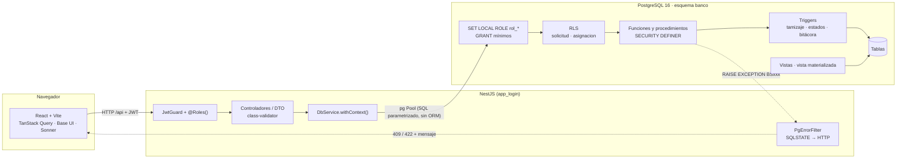
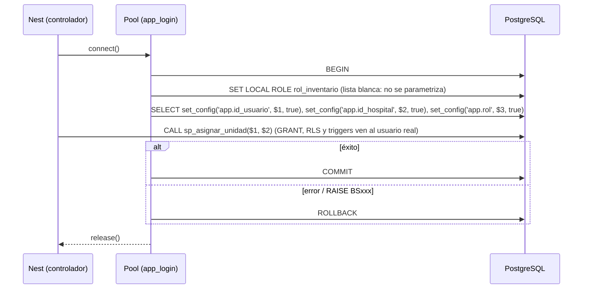
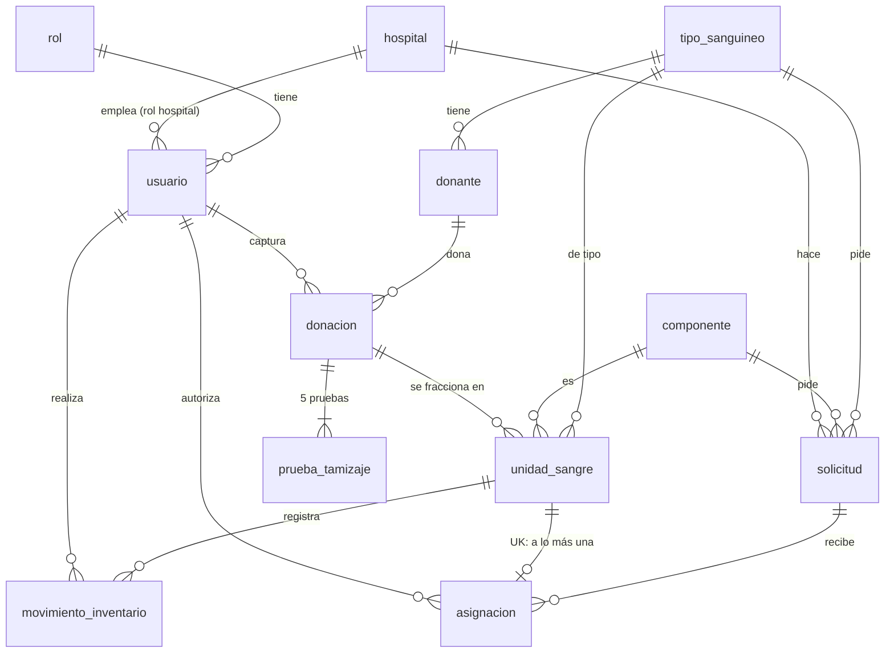
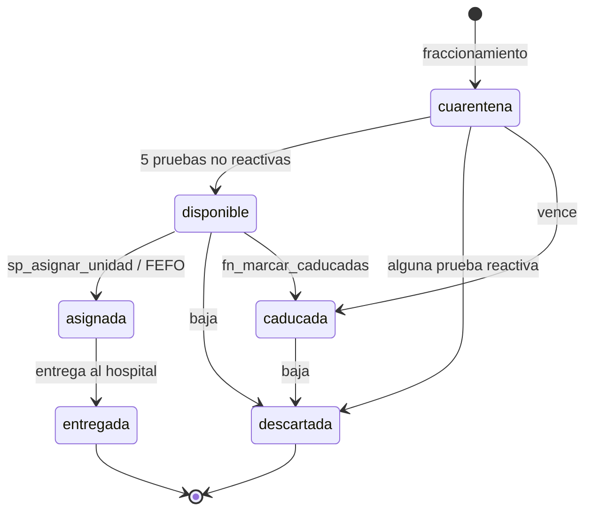
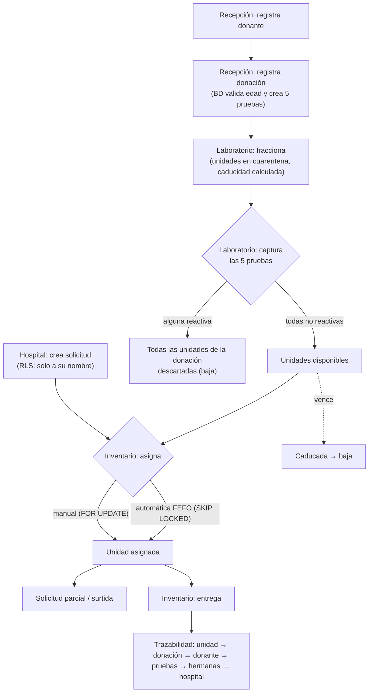

# Arquitectura — Banco de Sangre

Sistema web para administrar un banco de sangre: donantes, donaciones, tamizaje, fraccionamiento,
inventario con caducidad, solicitudes de hospitales, asignación y trazabilidad.
**El foco es la base de datos**: las reglas críticas viven en PostgreSQL (constraints, triggers,
funciones y procedimientos). NestJS y React son capas delgadas que validan, orquestan y muestran.

Contenido: [Vista general](#vista-general) · [Stack](#stack-y-versiones) · [Contexto por petición](#patrón-clave-contexto-de-bd-por-petición) ·
[Módulos](#módulos-de-la-api) · [Modelo de datos](#modelo-de-datos) · [Lógica en la BD](#lógica-de-negocio-en-postgresql) ·
[Flujo de operación](#flujo-de-operación) · [Concurrencia](#concurrencia) · [Seguridad](#seguridad) ·
[Rendimiento](#rendimiento) · [Respaldo](#respaldo-y-recuperación) · [Calidad](#atributos-de-calidad-y-evidencia) ·
[Despliegue](#despliegue) · [Limitaciones](#limitaciones-conocidas)

Ver también: `docs/archivos.md` (qué hay en cada carpeta), `docs/diseno.md` (guía visual),
`docs/evidencias/` (resultados) y `docs/guion-video.md`.

## Vista general

| Capa | Responsabilidad | No hace |
|---|---|---|
| React | Pantallas por rol, formularios con validación de forma, confirmaciones, notificaciones con el mensaje de la BD | No decide permisos ni reglas: ocultar un menú es solo comodidad |
| NestJS | Autenticación (JWT + argon2id), DTO, `@Roles()`, abrir la transacción con la identidad del usuario, traducir errores | No contiene reglas de negocio ni hace `UPDATE` de inventario: llama funciones de la BD |
| PostgreSQL | Integridad (PK/FK/UK/CHECK), máquina de estados, falla segura, asignación con bloqueo, caducidad, privilegios, RLS, bitácora | — |

## Stack y versiones

Versiones reales del entorno donde se desarrolló y probó.

| Componente | Versión |
|---|---|
| PostgreSQL | 16.16 (imagen `postgres:16-alpine`) |
| Node.js / npm | 22.23 LTS / 10.9 |
| TypeScript | 5.9 |
| NestJS | 11.2 · `pg` 8.23 (sin ORM) · `@nestjs/jwt` · `argon2` 0.41 · `class-validator` |
| React / Vite | 19.3 / 6.4 · React Router 7.18 · TanStack Query 5.107 · Tailwind CSS 4.3 · Base UI 1.9 · Sonner 2.0 |
| Pruebas | Jest 30 + supertest 7 contra la BD real `banco_test` |
| Contenedores | Docker 29.8, Compose v5 |
| Equipo de desarrollo | MacBook con Apple M4, 16 GB RAM, macOS 26.6 |

## Patrón clave: contexto de BD por petición

Toda operación de negocio pasa por `DbService.withContext(usuario, fn)` (`apps/api/src/db/contexto.ts`):

- `SET LOCAL` y `set_config(..., true)` duran **solo la transacción**: al regresar la conexión al pool
  no queda identidad pegada para la siguiente petición.
- `app_login` no tiene privilegios propios (`NOINHERIT`); únicamente puede *convertirse* en un rol
  de grupo con `SET ROLE`. Sin `withContext` no puede leer ninguna tabla de negocio.
- La bitácora registra `rol_app`, `usuario_app` y `usuario_bd`, que también es el rol del `SET ROLE` (migración 006).

## Módulos de la API

Prefijo `/api`. Cada endpoint declara `@Roles()`; la BD vuelve a verificar con GRANT y RLS.

| Módulo | Endpoints principales | Roles | Objetos de BD que usa |
|---|---|---|---|
| auth | `POST /auth/login`, `GET /auth/yo` | público / autenticado | `fn_credenciales_login` (SECURITY DEFINER) |
| donantes | `GET/POST/PATCH /donantes`, `GET/POST /donaciones` | recepción (escribe); laboratorio, inventario, admin (leen) | `donante`, `donacion`, triggers `tg_donacion_validar` (edad, BS008) y `tg_donacion_crear_pruebas` |
| laboratorio | `GET /laboratorio/donaciones`, `PATCH /laboratorio/pruebas/:id`, `POST …/fraccionar` | laboratorio | `UPDATE(resultado)` por columna, `tg_prueba_validar` (BS014), `tg_prueba_evaluar` → `fn_evaluar_tamizaje`, `fn_fraccionar_donacion` |
| inventario | `GET /inventario/unidades`, `/disponibilidad`, `/por-caducar`, `/compatibles/:id`, `POST …/baja`, `POST …/entregar` | inventario (escribe); laboratorio, admin (leen) | `v_inventario_unidades`, `v_disponibilidad`, `v_unidades_por_caducar`, `fn_marcar_caducadas`, `fn_dar_baja`, `fn_entregar_unidad` |
| solicitudes | `GET/POST /solicitudes`, `POST :id/asignar`, `:id/asignar-automatica`, `:id/cancelar` | hospital (crea, cancela); inventario (asigna) | RLS de `solicitud`, `sp_asignar_unidad`, `sp_asignar_automatica`, `fn_cancelar_solicitud` |
| trazabilidad | `GET /trazabilidad/unidades/:id` | inventario, admin | `v_trazabilidad_unidad` |
| hospitales | `GET /catalogos`, `GET/POST/PATCH /hospitales` | todos (catálogos); admin (escribe) | catálogos |
| admin | `GET /admin/bitacora`, `GET/POST/PATCH /admin/usuarios` | admin | `bitacora_auditoria` (solo SELECT), `tg_usuario_hospital` (BS016) |
| dashboard | `GET /dashboard` | todos | `fn_marcar_caducadas`, `fn_refrescar_dashboard`, `mv_dashboard`, `v_disponibilidad`, `v_unidades_por_caducar`, `v_solicitudes_pendientes` |

Errores: `PgErrorFilter` traduce los SQLSTATE propios `BS001`…`BS016` a 404/409/422 con el mensaje del
`RAISE` en español, y los estándar (`23505`, `23503`, `23514`, `42501`…) a mensajes accionables.

## Modelo de datos

Fuente de verdad: `docs/contexto/modelo-er.md` (TC16). Todos los objetos viven en el esquema `banco`.

Constraints que sostienen las reglas: `uk_prueba_donacion_tipo (id_donacion, tipo_prueba)` (una prueba
de cada tipo), `uk_unidad_donacion_componente` (un componente por donación), `uk_asignacion_unidad`
(segunda barrera contra la doble asignación), CHECK de estados, prioridades, resultados, edad, volumen,
vida útil y `ck_componente_alerta`. Identificadores `GENERATED ALWAYS AS IDENTITY`; tiempos `timestamptz`.

## Desviaciones respecto al modelo ER (TC16)

| Tabla.columna | Motivo |
|---|---|
| `usuario.password_hash varchar(255)` | Guardar el hash argon2id de la contraseña. El ER no contemplaba autenticación propia. |
| `bitacora_auditoria.usuario_app varchar(20)` | `id_usuario` de la persona que operó (`app.id_usuario`). `usuario_bd` solo dice el rol de BD. |
| `bitacora_auditoria.rol_app varchar(63)` | Rol de la app (`app.rol`), fijado por `withContext`. Es la fuente explícita de la identidad; `usuario_bd` la corrobora desde el lado de PostgreSQL. |
| `tipo_sanguineo.grupo_abo varchar(2)` + `CHECK (grupo_abo IN ('A','B','AB','O'))` | El ER lo define como `char`. `AB` tiene dos letras y `char(2)` rellenaría `A` como `'A '` con espacio, lo que complica comparaciones y etiquetas. El CHECK conserva el dominio cerrado de 4 grupos. |
| `componente.dias_alerta_caducidad integer` + `CHECK (dias_alerta_caducidad BETWEEN 1 AND vida_util_dias)` | No está en el ER. Umbral de "próxima a caducar" propio de cada componente (plaquetas 2, eritrocitos 7, plasma y crioprecipitado 30), porque un umbral fijo no sirve para vidas útiles de 5 a 365 días. Lo usan `v_inventario_unidades` (semáforo), `v_unidades_por_caducar`, `v_disponibilidad` y el dashboard. Migración `007`. |

`bitacora_auditoria.usuario_bd` se llena con `coalesce(nullif(current_setting('role'), 'none'), session_user)` (migración `006`), no con `current_user`: dentro de la función `SECURITY DEFINER` del trigger, `current_user` siempre es el dueño (`banco_owner`), mientras que el GUC `role` conserva el `SET LOCAL ROLE` de la petición. En peticiones de la app `usuario_bd = rol_app`; en migraciones/seeds (sin `SET ROLE`) queda `session_user`.

Precisiones de tipo (no cambian el modelo):
- Las columnas *timestamp* del ER son `timestamptz` (instante absoluto; se muestran en America/Mexico_City).
- Estados y prioridades son `varchar + CHECK` (no ENUM); el porqué está en `001_esquema.sql`.

## Lógica de negocio en PostgreSQL

Migraciones numeradas en `db/migrations/` (runner propio `db/migrate.ts` con checksum por archivo):
`001_esquema` · `002_catalogos` · `003_logica` · `004_seguridad` · `005_indices_vistas` · `006_bitacora_usuario_bd` · `007_alerta_caducidad_por_componente`.

| Regla | Implementación | SQLSTATE |
|---|---|---|
| Edad del donante 18–65 | `tg_donacion_validar` (BEFORE INSERT donacion) | BS008 |
| 5 pruebas obligatorias por donación | `tg_donacion_crear_pruebas` (AFTER INSERT) | — |
| Un resultado definitivo no cambia | `tg_prueba_validar` (BEFORE UPDATE) | BS014 |
| **Falla segura**: la unidad nace en cuarentena; 5 no reactivas → disponible; 1 reactiva → todas las unidades de la donación descartadas con movimiento `baja` | `tg_prueba_evaluar` → `fn_evaluar_tamizaje` | — |
| Fraccionamiento con caducidad = obtención + vida útil y movimiento `entrada` | `fn_fraccionar_donacion(id, componentes[])` | BS009 |
| Máquina de estados de la unidad | `tg_unidad_transicion` (BEFORE UPDATE OF estado) | BS010 |
| Asignación manual con bloqueo de fila | `sp_asignar_unidad` (`SELECT … FOR UPDATE`) + UK | BS001–BS006, BS012 |
| Asignación automática FEFO | `sp_asignar_automatica` (`FOR UPDATE SKIP LOCKED`) | BS005, BS011 |
| Estado de la solicitud (pendiente/parcial/surtida) | `fn_recalcular_solicitud` | — |
| Solo se cancela una solicitud **pendiente** (sin unidades asignadas); un hospital solo cancela las suyas | `fn_cancelar_solicitud` | BS007, BS010 |
| Caducidad sin cron | `fn_marcar_caducadas()`, invocada al consultar inventario y dashboard | — |
| Bajas y entregas | `fn_dar_baja`, `fn_entregar_unidad` | BS010 |
| Usuario de hospital ⇔ con hospital | `tg_usuario_hospital` | BS016 |
| Bitácora inmodificable | `tg_bitacora` (AFTER I/U/D en 9 tablas), `tg_bitacora_inmutable`, `tg_bitacora_no_truncate` | BS013 |

Ningún rol tiene `UPDATE` sobre `unidad_sangre`: el inventario solo cambia a través de estas funciones.
Toda función `SECURITY DEFINER` lleva `SET search_path = banco, pg_temp`, `REVOKE EXECUTE … FROM PUBLIC`
y `GRANT EXECUTE` solo al rol que la usa.

## Flujo de operación

Capturas de cada paso en `docs/evidencias/capturas/` (por ejemplo `web-laboratorio-liberacion.jpg`,
`web-solicitud-confirmar-fefo.jpg`, `web-trazabilidad.jpg`).

## Concurrencia

- **Asignación manual** (`sp_asignar_unidad`): `SELECT … FROM unidad_sangre WHERE id_unidad = $1 FOR UPDATE`
  bloquea la fila; una segunda transacción que pida la misma unidad **espera** y, cuando la primera
  confirma, relee el estado (`asignada`) y falla con BS001. Si algo esquivara el bloqueo, la UK
  `uk_asignacion_unidad` rechaza la segunda fila (23505). Todo ocurre en una transacción: cualquier
  fallo revierte la asignación, el cambio de estado y el movimiento.
- **Asignación FEFO** (`sp_asignar_automatica`): `ORDER BY fecha_caducidad … FOR UPDATE SKIP LOCKED`.
  Las unidades bloqueadas por otra transacción se saltan en lugar de esperarlas, así dos asignaciones
  simultáneas toman unidades distintas sin bloquearse entre sí.
- **Dashboard**: `fn_refrescar_dashboard` usa `pg_try_advisory_xact_lock` para que, de N peticiones
  simultáneas, solo una refresque la vista materializada (`REFRESH … CONCURRENTLY`).
- Pool con `statement_timeout = 10 s`: ninguna sentencia retiene una conexión indefinidamente.

Resultado (`docs/evidencias/resultados-concurrencia.md`): 20 transacciones simultáneas sobre la misma
unidad → **1 éxito y 19 rechazos BS001**, 1 fila en `asignacion`, 1 movimiento de salida.

## Seguridad

### Roles de base de datos

| Rol | Tipo | Para qué |
|---|---|---|
| `postgres` | superusuario | Solo bootstrap: crear roles y bases (`db/lib/bootstrap.ts`). |
| `banco_owner` | LOGIN, no superusuario | Dueño del esquema `banco`; corre migraciones; las funciones `SECURITY DEFINER` corren con sus privilegios. |
| `app_login` | LOGIN, NOINHERIT | Cuenta de conexión de la API. No tiene privilegios propios; es miembro de los roles de grupo con `INHERIT FALSE, SET TRUE`, así que solo puede usarlos mediante `SET ROLE`. |
| `rol_recepcion` · `rol_laboratorio` · `rol_inventario` · `rol_hospital` · `rol_admin` | NOLOGIN | Privilegios mínimos por función (ver `004_seguridad.sql`). |

Capas de seguridad (defensa en profundidad):
GRANT por tabla y columna → RLS por hospital (`solicitud`, `asignacion`) → reglas en funciones `SECURITY DEFINER` → triggers (máquina de estados, bitácora inmutable) → `@Roles()` en Nest → menú por rol en React.

### Autenticación
- Contraseñas con **argon2id** (`argon2.hash`, parámetros por defecto: 64 MiB, 3 iteraciones).
  `fn_credenciales_login` es la única puerta de `app_login` a la tabla `usuario` y devuelve solo al
  usuario pedido y activo. Un hash señuelo iguala el tiempo de respuesta si el usuario no existe.
- `admin` no tiene `SELECT` sobre `usuario.password_hash` (privilegio por columna); la bitácora
  excluye ese campo.
- PostgreSQL acepta solo **SCRAM-SHA-256** (`POSTGRES_INITDB_ARGS`). Secretos solo en `.env`.

### Row-Level Security
La RLS está activa en **dos tablas**, ambas con el hospital de la sesión (`app.id_hospital`,
fijado por `withContext`, leído con `fn_hospital_actual()`):

| Tabla | Política | Rol | Regla |
|---|---|---|---|
| `solicitud` | `pol_solicitud_hospital` | `rol_hospital` | `USING` y `WITH CHECK id_hospital = fn_hospital_actual()`: solo lee **y crea** solicitudes de su hospital |
| `solicitud` | `pol_solicitud_personal` | `rol_inventario`, `rol_admin` | `SELECT` de todas |
| `asignacion` | `pol_asignacion_hospital` | `rol_hospital` | `SELECT` solo si `EXISTS` su solicitud; esa subconsulta también pasa por la RLS de `solicitud` |
| `asignacion` | `pol_asignacion_personal` | `rol_inventario`, `rol_admin` | `SELECT` de todas |

Sin una política que aplique, el rol no ve ninguna fila (falla segura). El dueño (`banco_owner`)
no está sujeto a RLS, por eso las funciones `SECURITY DEFINER` de asignación ven todas las
solicitudes. Las vistas que exponen estos datos (`v_solicitudes_pendientes`) son
`security_invoker`, así que la RLS se aplica también a través de ellas. Verificado en
`seguridad.spec.ts` y en el e2e (el hospital sur recibe 404 al pedir una solicitud del norte).

### Bitácora de auditoría
Trigger genérico `AFTER INSERT/UPDATE/DELETE` en 9 tablas → `bitacora_auditoria` con `to_jsonb(OLD/NEW)`,
`usuario_bd`, `rol_app` y `usuario_app`. Es `SECURITY DEFINER` porque ningún rol de la app tiene `INSERT`
en la bitácora (no pueden fabricar registros). Inmodificable en dos capas: sin `UPDATE/DELETE/TRUNCATE`
para nadie de la app y triggers que rechazan cualquier intento (BS013), incluso del dueño.

## Rendimiento

| Objeto | Para qué |
|---|---|
| `ix_unidad_disponible (id_tipo_sanguineo, id_componente, fecha_caducidad) WHERE estado = 'disponible'` | Índice **parcial**: solo indexa las disponibles (≈10 % de las filas). Sirve a disponibilidad, compatibles y FEFO ya ordenado por caducidad |
| `ix_unidad_vigente_caducidad` | Búsquedas por caducidad entre cuarentena y disponibles (`fn_marcar_caducadas`, por caducar) |
| Índices en FK de joins frecuentes | `ix_donacion_donante`, `ix_movimiento_unidad`, `ix_asignacion_solicitud`, `ix_solicitud_hospital`, `ix_usuario_hospital`, `ix_solicitud_abierta` (parcial) |
| `ix_bitacora_fecha_brin` | Índice **BRIN** por fecha: diminuto, ideal para una tabla que solo crece en orden cronológico |
| Vistas | `v_disponibilidad`, `v_inventario_unidades` (semáforo), `v_unidades_por_caducar`, `v_solicitudes_pendientes`, `v_trazabilidad_unidad` |
| `mv_dashboard` + `ux_mv_dashboard` | Vista materializada con índice único para `REFRESH CONCURRENTLY` (no bloquea lecturas); se refresca a lo más cada minuto |

Resultado (`docs/evidencias/benchmark.md`, 100 138 unidades, `EXPLAIN ANALYZE BUFFERS`, mediana de 15):
disponibilidad de un tipo × componente **−98.7 %**, selección FEFO **−99.6 %**, por caducar **−97.5 %**.
Con 100 000 unidades la API responde en ≤ 90 ms (`docs/evidencias/break-ui.md`).

## Respaldo y recuperación

| Estrategia | Herramienta | RPO medido | RTO medido |
|---|---|---|---|
| Respaldo lógico | `scripts/backup.sh` (`pg_dump -Fc` + `pg_dumpall --roles-only`), `scripts/restore.sh` (`pg_restore -j 4`) | todo lo posterior al último respaldo | ≈1 s para la base de 100k unidades |
| Archivado continuo + PITR | `archive_mode=on` en `docker-compose.yml`, `pg_basebackup -X stream`, `recovery_target_time` (`scripts/prueba-pitr.sh`) | solo lo posterior al instante elegido | ≈1 s para el clúster de 223 MB |

Procedimiento, línea de tiempo con LSN, timeline nuevo y explicación de WAL/LSN/timeline:
`docs/evidencias/restauracion.md`.

## Atributos de calidad y evidencia

| Atributo (ISO/IEC 25010) | Cómo se atiende | Evidencia |
|---|---|---|
| Seguridad | Privilegios mínimos, `app_login` sin privilegios, RLS, SCRAM, argon2id, bitácora inmodificable, defensa en profundidad | `resultados-seguridad.md`, `resultados-e2e.md`, `web-bitacora-usuario-bd.jpg` |
| Protección (safety) | Falla segura por tamizaje, rechazo de caducadas/reactivas/pendientes/tipo o componente distinto, alertas de caducidad, trazabilidad de hermanas | `resultados-reglas.md`, `web-laboratorio-liberacion.jpg`, `web-trazabilidad.jpg` |
| Disponibilidad | Transacciones atómicas, errores claros, respaldo lógico y PITR medidos, API que sobrevive a conexiones perdidas | `restauracion.md` |
| Escalabilidad / rendimiento | Índices parciales, BRIN, vista materializada, paginación con `LIMIT/OFFSET`, pruebas con 100k unidades | `benchmark.md`, `break-ui.md` |
| Usabilidad | Pantallas por rol, listas de selección, confirmaciones antes de asignar o dar de baja, mensajes de la BD en español con su código, responsivo | `capturas/`, `break-ui.md`, `docs/diseno.md` |
| Integridad / concurrencia | FK, UK, CHECK, `FOR UPDATE`, `SKIP LOCKED` | `resultados-concurrencia.md` |

## Despliegue

Desarrollo: `docker compose up -d db` (PostgreSQL con archivado de WAL) + `npm run dev` (Nest en :3000,
Vite en :5173 con proxy de `/api`). El despliegue completo con contenedores se documenta en la
sección siguiente cuando se agrega `docker-compose.prod.yml` (`feature/infra-docker`).

## Limitaciones conocidas

### El JWT vive en `localStorage`
La web guarda el token en `localStorage` (`apps/web/src/api/cliente.ts`) y lo manda en
`Authorization: Bearer`. Es simple y suficiente para el proyecto, pero **cualquier script que
corra en la página puede leerlo**: una vulnerabilidad XSS permitiría robar la sesión hasta que
el token expire (`JWT_EXPIRES_IN`, 8 h por defecto). React escapa el contenido por defecto y la
app no usa `dangerouslySetInnerHTML`, lo que reduce el riesgo, pero no lo elimina (dependencias
de terceros, extensiones).

**Mitigación (no implementada):** emitir el token en una cookie `HttpOnly; Secure; SameSite=Strict`
(o `Lax`) desde `/api/auth/login`. JavaScript no podría leerla y `SameSite` bloquea su envío en
peticiones de otros sitios (CSRF); para operaciones que cambian estado conviene además un
token anti-CSRF. Como web y API comparten origen tras nginx (`/api`), el cambio sería local a
`AuthModule` y al cliente HTTP.

### La autorización real la aplica la base de datos
Ocultar menús en React y los `@Roles()` de Nest son **comodidad y defensa en profundidad**, no la
barrera principal. En cada petición `withContext` hace `SET LOCAL ROLE <rol>` y fija `app.id_usuario`,
`app.id_hospital` y `app.rol`; a partir de ahí PostgreSQL decide con:
- `GRANT` mínimos por rol (p. ej. ningún rol tiene `UPDATE` sobre `unidad_sangre`; solo se cambia vía funciones),
- RLS en `solicitud` y `asignacion` por `app.id_hospital` (ver «Row-Level Security» más abajo),
- funciones `SECURITY DEFINER` con validaciones y SQLSTATE propios,
- bitácora inmodificable por trigger.

Consecuencia: un token robado da exactamente los permisos de BD de ese rol y ese hospital, nada más;
y un error en la UI o en un guard de Nest no abre datos que la BD no permita (las pruebas de
`seguridad.spec.ts` lo verifican ejecutando SQL directo con cada rol).

### La carga sintética no pasa por la bitácora
`npm run db:sintetico` (y `db:reset`, que lo invoca) es una **carga inicial**, no actividad de la
aplicación. `db/sintetico/generar.sql` corre como `banco_owner` y desactiva los triggers de usuario
(`ALTER TABLE … DISABLE TRIGGER USER`) durante la transacción:

- No dispara la bitácora: esas filas no las creó ningún usuario de la app, así que no tienen
  `rol_app` ni `usuario_app` que registrar. Escribir 100 000 filas de auditoría falsas además
  distorsionaría el benchmark.
- Tampoco dispara las reglas por fila (tamizaje, máquina de estados): los estados finales se
  calculan en bloque con SQL coherente con esas reglas.
- Las **FK sí se verifican**: son triggers internos del sistema y `DISABLE TRIGGER USER` no los toca.
- `DISABLE TRIGGER` toma un candado `ACCESS EXCLUSIVE` (nadie más usa la tabla) y todo vuelve a
  la normalidad con el `COMMIT`.

Por eso, en una base recién reiniciada, la bitácora solo contiene los seeds (hospitales y
usuarios demo, con `usuario_bd = banco_owner` y sin `rol_app`). Todo lo que se hace desde la app
o desde las pruebas sí queda registrado, con el rol de la petición.
